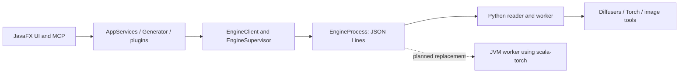

# Stable Diffusion NUI migration inventory

**Current target:** the user identified `/home/mizushima/dev/stablediffusion-nui` on2026-11-03. See the [refreshed local inventory and integration plan](nui-current-migration.md). The8823aa4 tables below remain historical evidence, not the current complete surface.

Snapshot: [kmizu/stablediffusion-nui at 8823aa413a3b3a1db682456357b15ee681387554](https://github.com/kmizu/stablediffusion-nui/tree/8823aa413a3b3a1db682456357b15ee681387554), inspected locally on 2026-11-02. This supplements the earlier audit at revision1f41743; it does not silently treat those revisions as identical. App version0.03, protocol version1. The upstream checkout was read only; no NUI source was changed or incorporated into scala-torch.

This is a complete static enumeration of the selected dispatch table, registered standard plugins and Python package files at that revision. It is **not** a completed behavioral audit, a runtime test, or evidence that any NUI feature has been ported. Every migration row remains open. NUI source carries AGPLv3; the future integration boundary must remain separate from generic scala-torch implementation work.

## Indexed evidence

| Inventory | Count | What it establishes |
|---|---:|---|
| [Worker requests](nui/requests.csv) | 47 | 41 queued request names plus6 reader/control requests; each queued name resolves to Engine or BaseEngine |
| [Standard plugins](nui/plugins.csv) | 117 | 33 scripts,16 extras,68 AlwaysOn entries; each has a unique class and ID |
| [Python parameter fields](nui/generation-fields.csv) | 97 | Annotated fields across request/parameter classes in params.py, with source lines |
| [Python modules](nui/python-modules.csv) | 135 | Every .py file beneath python/sdfx, source SHA-256, line count and direct imports;34628 physical source lines |
| [Scala request references](nui/scala-request-references.csv) | 254 | Literal request names or Protocol.Types references in Scala production sources; references are not necessarily calls |
| [Snapshot summary](nui/inventory-summary.json) | — | Counts and unresolved-extraction checks |

Extraction used Python AST parsing without importing or executing the worker and static Scala declaration/registry scans. Independent checks compared all registry `new …Plugin` entries to the117 catalog rows, required unique IDs/classes, checked all47 unique dispatch names and resolved handlers, matched all135 package files, and verified every recorded source line against the pinned checkout. Three plugin IDs are companion constants and were explicitly resolved. Blank plugin hook/feature/request cells mean “not found by this direct scan,” not “has no engine dependency.” Import lists record module clauses (a bare relative `from . import ...` is represented by `.`); imported symbols are not resolved. Imports and references are not a transitive call graph. Nested operation strings, plugin control defaults and interaction semantics still need detailed fixture mapping.

Nineteen accepted requests have no matching Scala Protocol.Types constant: aesthetic_embedding, animatediff_encode, batch_interrogate_execute, batch_interrogate_prepare, caption, convert_model, embedding_editor, embedding_inspector, image_tool, img2vid, inpaint_difference_preview, merge_models, model_keyword, model_keyword_plan, novel_view, restore_faces, run_code, system_submission_preview and system_submit. The migration boundary therefore comes from [server dispatch](https://github.com/kmizu/stablediffusion-nui/blob/8823aa413a3b3a1db682456357b15ee681387554/python/sdfx/server.py#L22), not just Protocol.scala.

## Existing boundary and replacement seam

[AppServices](https://github.com/kmizu/stablediffusion-nui/blob/8823aa413a3b3a1db682456357b15ee681387554/engine/src/main/scala/sdfx/engine/AppServices.scala#L23) already accepts a launch override; its default at line89 uses PythonEnv.engineLaunch. This is the concrete test seam for a JVM worker. Preserve the subprocess boundary first, so existing EngineClient/Supervisor, GUI and MCP can exercise the replacement through the same envelopes. An in-process engine is a later option, not a prerequisite.

[EngineProcess](https://github.com/kmizu/stablediffusion-nui/blob/8823aa413a3b3a1db682456357b15ee681387554/engine/src/main/scala/sdfx/engine/EngineProcess.scala#L29) launches a command and waits for hello. The worker emits request-ID-correlated result/error/event lines, with hello first. Preserve progress/preview/log routing, UTF-8 framing, process exit behavior and pending-request completion. EngineHello currently exposes Python/Torch/Diffusers strings; represent the new backend honestly while retaining a compatible transition schema. Feature advertisements are conditional in [Engine.features](https://github.com/kmizu/stablediffusion-nui/blob/8823aa413a3b3a1db682456357b15ee681387554/python/sdfx/engine.py#L196); a JVM worker must advertise only implemented/tested capabilities.

Cancellation is a state machine, not a thread interrupt. [Server admission](https://github.com/kmizu/stablediffusion-nui/blob/8823aa413a3b3a1db682456357b15ee681387554/python/sdfx/server.py#L114) couples protection revision, job ownership, active/queued IDs and too-late publication state. [JobContext](https://github.com/kmizu/stablediffusion-nui/blob/8823aa413a3b3a1db682456357b15ee681387554/python/sdfx/protocol.py#L131) tracks open/committing/committed publication. Preserve denied cancellation without modifying native state, owner-target matching, queued cancellation, restart authorization and post-commit rejection. The transport also carries image-password and plaintext-video permission separately from model parameters; these must not leak into logs/results or survive an idle job context.

[GenerationResult](https://github.com/kmizu/stablediffusion-nui/blob/8823aa413a3b3a1db682456357b15ee681387554/core/src/main/scala/sdfx/core/protocol/Protocol.scala#L162) and [Generator publication](https://github.com/kmizu/stablediffusion-nui/blob/8823aa413a3b3a1db682456357b15ee681387554/engine/src/main/scala/sdfx/engine/Generator.scala#L722) require more than final pixels: hashes, seeds/subseeds, warnings, effective prompts, timing, intermediate manifests/video, composable-LoRA traces, VAE recovery, auxiliary images and PNG/infotext metadata. Temporary-image ownership and gallery exclusion rules must survive replacement.

## Migration work packages

Each request/plugin row carries a proposed gate identifier and remains unported. Those identifiers name tests to create; they do not claim tests exist.

| Package | Required implementation | Evidence needed before closure |
|---|---|---|
| Worker transport/lifecycle | JVM JSONL worker, hello/features, queue, controls, error mapping, restart and publication ownership | Existing Scala process/supervisor/client exercised against JVM worker; malformed input, crash, denied/late cancellation and secret-lifetime cases |
| Base diffusion | CLIP conditioning, U-Net, VAE, scheduler/CFG, seeded latent preparation, SD1.x/SD2/SDXL configurations and inpainting variants | Independent component tensors and fixed-input denoise comparisons, then real text-to-image/image-to-image/inpaint outputs |
| Conditioning | Weighted prompt parser, BREAK/chunks, clip skip, textual inversion, schedules, positive/negative and dual-encoder behavior | Token IDs, multipliers, conditioning tensors and replay fixtures; existing Llama BPE/RoPE is insufficient |
| Hires and image workflows | Latent/pixel upscale, masks, loopback/outpaint, hires-specific seeds/prompts/LoRAs, batching | Multi-pass dimensions/seeds/masks and image/metadata ownership fixtures |
| Model modifications | LoRA/LBW/composable LoRA, ControlNet/preprocessors, IP/other adapters, guidance and attention hooks | Per-module numerical fixtures plus each registered plugin's default/off/on and important interaction tests |
| Image/auxiliary tools | Upscalers, face restore/swap, segmentation/background removal, NSFW/aesthetic, BLIP/WD/CLIP interrogation | Original input/output schemas, model identities/hashes, batch partial-result/cancel behavior, image/metadata checks |
| Temporal tools | SVD, AnimateDiff, novel views, temporal_lab, video encoding/preview | Frame/manifest timing and seed fixtures, cancellation/publication, offline codecs and UI/MCP playback |
| Model/embedding utilities | Merge/convert, safetensors metadata, embedding editor/inspector/merge, model keyword mappings | Byte/hash-preserving edits where required, numerical merge fixtures, reload and conflict/stale-token cases |
| Diagnostics | Memory/status/VRAM estimation, benchmark, system info/submission preview/submit | Native telemetry and estimation checks; preserve explicit submission actions without automatic network sends |
| Custom extensions | Scala extension API replacing Python run_code, with explicit migration documentation | Ported representative scripts and equivalent stdout/result/image contract; migration policy still open |
| Packaging/UI/MCP | JVM worker default, settings/bootstrap migration, native/model assets, Windows distribution | Packaged Windows run with no Python installed: actual UI+MCP generation, cancel, preview, restart and offline use |

The current Python [prompt chunker](https://github.com/kmizu/stablediffusion-nui/blob/8823aa413a3b3a1db682456357b15ee681387554/python/sdfx/prompt.py#L120) produces75 content-token chunks with BOS/EOS; the [pipeline table](https://github.com/kmizu/stablediffusion-nui/blob/8823aa413a3b3a1db682456357b15ee681387554/python/sdfx/engine.py#L42) includes SD1.5, SD2, SDXL and inpainting. These are concrete requirements to carry into CLIP/diffusion plans. A successful Llama generation does not exercise them.

Two compatibility decisions must be resolved without silently dropping features. [run_code](https://github.com/kmizu/stablediffusion-nui/blob/8823aa413a3b3a1db682456357b15ee681387554/python/sdfx/extras.py#L155) executes opted-in Python against engine/pipe/torch/image/context objects. Proposed replacement is a documented Scala extension API with corresponding output channels, not a claim of Python-source compatibility. Also, [legacy checkpoint loading](https://github.com/kmizu/stablediffusion-nui/blob/8823aa413a3b3a1db682456357b15ee681387554/python/sdfx/engine.py#L122) uses restricted Torch loading, while scala-torch currently accepts safetensors. A Python-free format-migration route or an explicitly agreed migration policy is still required for those users. Neither issue prevents continuing the generic tensor/diffusion work now.

## Python exit checklist

| Existing dependency | Source evidence | Replacement gate |
|---|---|---|
| Interpreter selection, venv/pip, environment and worker command | [PythonEnv](https://github.com/kmizu/stablediffusion-nui/blob/8823aa413a3b3a1db682456357b15ee681387554/engine/src/main/scala/sdfx/engine/PythonEnv.scala#L109) | Launch JVM worker and native/model asset checks; no interpreter probing or pip |
| Startup bootstrap dialog | [SdfxApp](https://github.com/kmizu/stablediffusion-nui/blob/8823aa413a3b3a1db682456357b15ee681387554/ui/src/main/scala/sdfx/ui/SdfxApp.scala#L46), [BootstrapDialog](https://github.com/kmizu/stablediffusion-nui/blob/8823aa413a3b3a1db682456357b15ee681387554/ui/src/main/scala/sdfx/ui/view/BootstrapDialog.scala#L86) | First launch without Python; actionable native/assets setup |
| Python executable setting/restart trigger | [SettingsDialog](https://github.com/kmizu/stablediffusion-nui/blob/8823aa413a3b3a1db682456357b15ee681387554/ui/src/main/scala/sdfx/ui/view/SettingsDialog.scala#L129), [Settings](https://github.com/kmizu/stablediffusion-nui/blob/8823aa413a3b3a1db682456357b15ee681387554/core/src/main/scala/sdfx/core/config/Settings.scala#L49) | Existing settings migrate without resetting unrelated user values |
| Packaged Python source/requirements | [package_windows.ps1](https://github.com/kmizu/stablediffusion-nui/blob/8823aa413a3b3a1db682456357b15ee681387554/scripts/package_windows.ps1#L57) | JVM/native payload and complete notices; no bundled Python requirement |
| Notice/license generation | [third_party.py](https://github.com/kmizu/stablediffusion-nui/blob/8823aa413a3b3a1db682456357b15ee681387554/scripts/third_party.py#L1) | JVM or other non-Python maintenance replacement with preserved notice content |
| Documentation site and test/smoke tooling | [pages workflow](https://github.com/kmizu/stablediffusion-nui/blob/8823aa413a3b3a1db682456357b15ee681387554/.github/workflows/pages.yml#L23), [test-all.sh](https://github.com/kmizu/stablediffusion-nui/blob/8823aa413a3b3a1db682456357b15ee681387554/scripts/test-all.sh#L6) | Separate optional reference tests from Python-free build/distribution/maintenance gates |

## Next implementation boundary

The application worker now crosses the existing NUI JSON Lines launch seam and
supports tiny-checkpoint SD1.5/SDXL text-to-image, standard linear LoRA,
img2img (including four-channel masked img2img), image metadata/replay, and
sequential `batch_size × n_iter`. These are verified subsets; the default NUI
engine remains Python. Continue from the refreshed 48-request/121-plugin
inventory, porting high-value generation and model capabilities while keeping
unsupported requests explicit. In particular, normal-checkpoint quality and
throughput, full-resolution mask crops, ControlNet, textual-inversion
embeddings, Hires, remaining plugin/runtime extension behavior, packaging, and
Python-absent JavaFX/MCP acceptance are still open. Preserve the complete
application scope; the native worker, one image, or a tiny model does not mark
Python removal complete.

M0 remains open for deeper module behavior, nested operations/control settings,
complete fixture mapping and the remaining numscala ownership/workspace audit.
